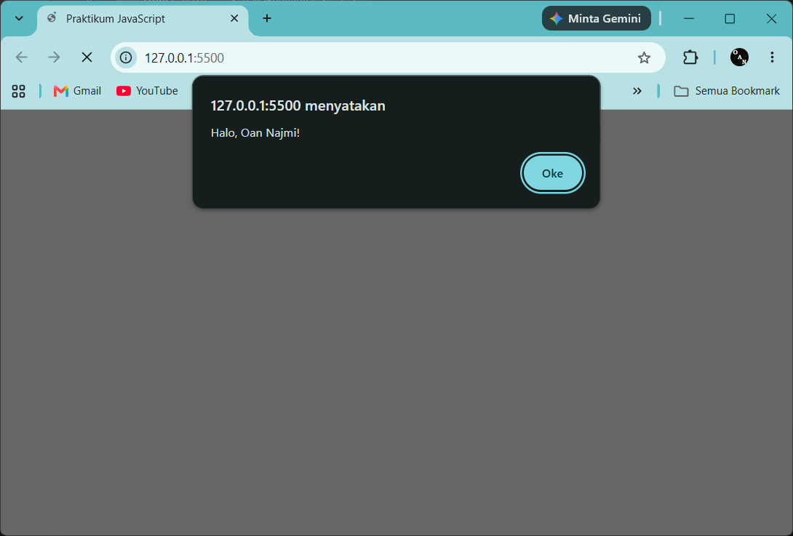
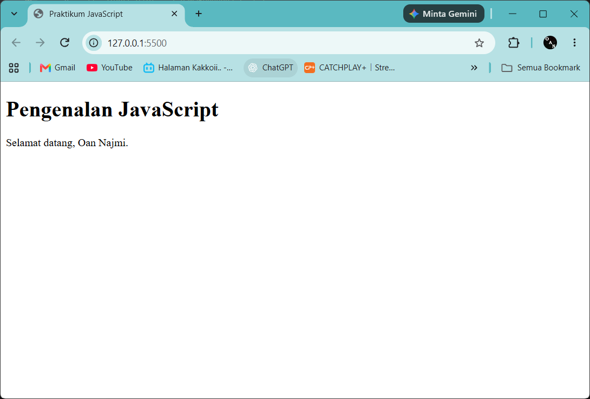
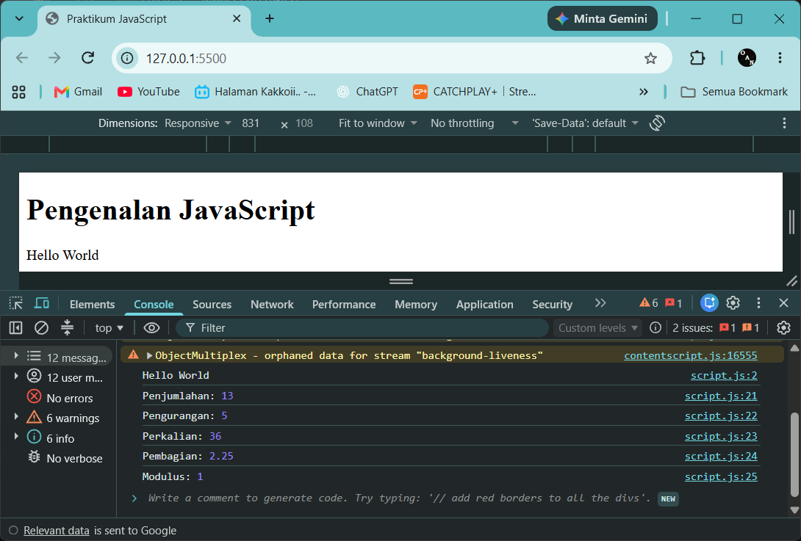
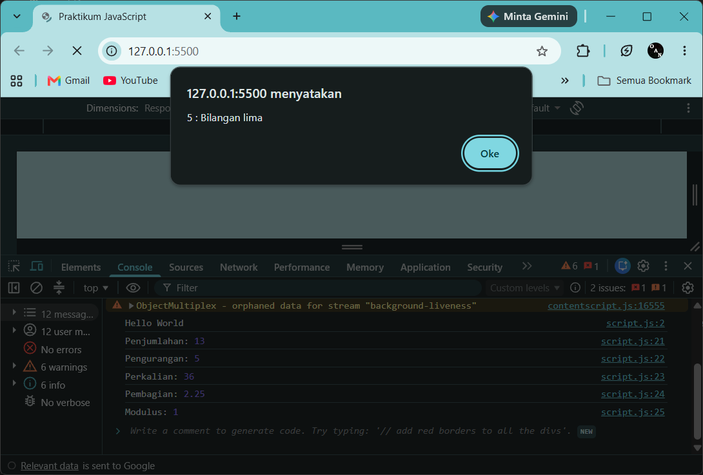
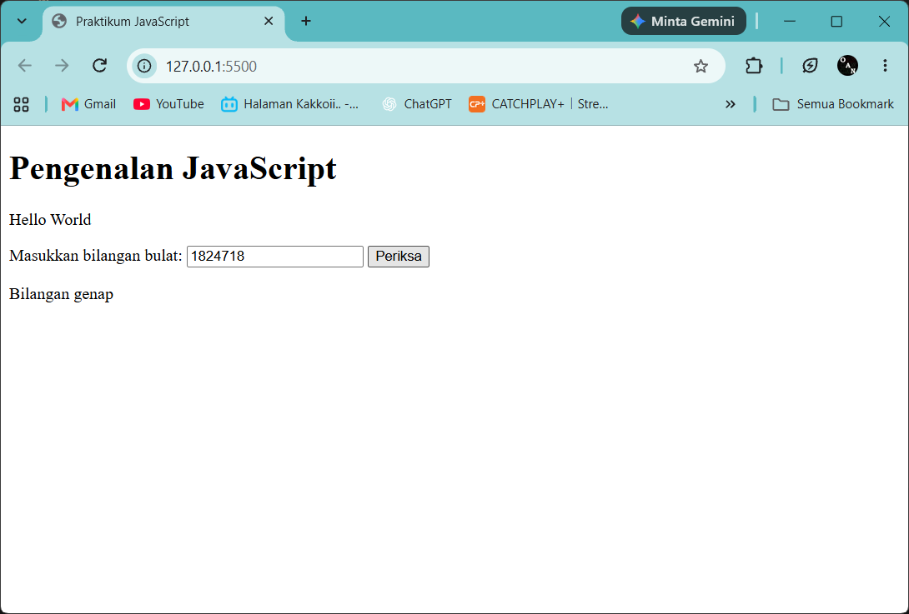
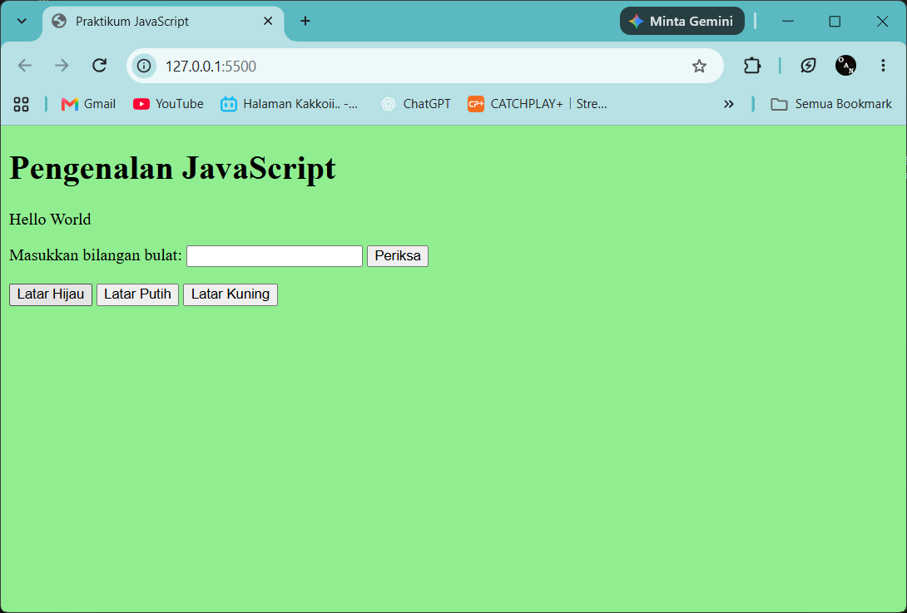
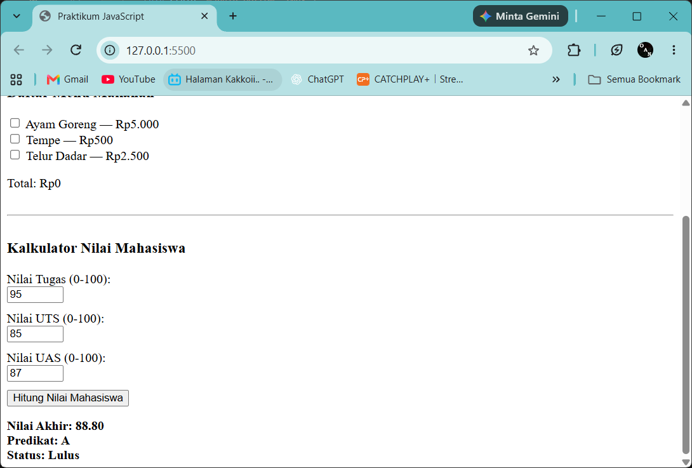

# Langkah Praktikum 5 - Pemrograman Web

**Nama:** Oan Najmi Zertho  
**NIM/Kelas:** 321510027 / I.25.3A  
**Prodi:** Teknik Informatika  
**Mata Kuliah:** Pemrograman Web  
**Dosen:** Agung Nugroho S.Kom, M.Kom

## Langkah Praktikum - Pengenalan JavaScript

Praktikum ini memperkenalkan dasar-dasar JavaScript melalui file `index.html` dan `script.js`. Materi dimulai dari menampilkan output, `alert` dan `prompt`, function, operasi aritmatika, seleksi kondisi `if-else` dan `switch`, hingga manipulasi DOM pada form bilangan genap/ganjil, pengubah warna halaman, dan checkbox menu makanan. Di akhir praktikum dibuat mini project berupa Kalkulator Nilai Mahasiswa.

## Persiapan struktur dokumen HTML

Buat file `index.html` dan `script.js` dalam satu folder. File JavaScript dihubungkan menggunakan tag `<script>` yang diletakkan di bagian paling bawah `<body>`, agar seluruh elemen HTML sudah dimuat sebelum script dijalankan.

```html
<!doctype html>
<html lang="id">
	<head>
		<meta charset="UTF-8" />
		<meta name="viewport" content="width=device-width, initial-scale=1.0" />
		<title>Praktikum JavaScript</title>
	</head>
	<body>
		<h1>Pengenalan JavaScript</h1>
		<p id="pesan">Konten awal.</p>

		<script src="script.js"></script>
	</body>
</html>
```

- `lang="id"`: Menandakan bahasa dokumen adalah Bahasa Indonesia.
- `<p id="pesan">`: Paragraf dengan `id` agar dapat diambil dan diubah isinya oleh JavaScript.
- `<script src="script.js"></script>`: Memuat file `script.js` setelah semua elemen HTML dibaca browser.

### Bagian 1 - Dasar JavaScript

Latihan 1 sampai 5 dijalankan satu per satu. Pada `script.js` akhir, kode latihan yang memakai `alert` dan `prompt` diberi komentar (`//`) agar jendela popup tidak muncul terus-menerus saat halaman dibuka.

#### 1. Menampilkan output

```javascript
document.getElementById("pesan").textContent = "Hello World";
console.log("Hello World");

const namaPengguna = prompt("Masukkan nama Anda:", "");
if (namaPengguna && namaPengguna.trim() !== "") {
	alert("Halo, " + namaPengguna + "!");
}
```

- `document.getElementById("pesan").textContent`: Mengambil elemen dengan `id="pesan"` lalu mengganti teks di dalamnya menjadi `Hello World`.
- `console.log()`: Menampilkan output ke console browser (dibuka dengan `F12`).
- `prompt()`: Menampilkan kotak dialog untuk memasukkan teks. Nilai yang dikembalikan disimpan pada konstanta `namaPengguna`.
- `namaPengguna && namaPengguna.trim() !== ""`: Memastikan pengguna tidak menekan _Cancel_ (`null`) dan tidak mengisi nama dengan spasi saja.
- `alert()`: Menampilkan kotak pesan sapaan kepada pengguna.



#### 2. Alert dan Prompt

```javascript
const namaPengguna = prompt("Masukkan nama Anda:", "");
if (namaPengguna && namaPengguna.trim() !== "") {
	alert("Halo, " + namaPengguna + "!");
	document.getElementById("pesan").textContent =
		"Selamat datang, " + namaPengguna + ".";
} else {
	alert("Nama belum diisi.");
}
```

- `if ... else`: Jika nama terisi, tampil sapaan dan teks pada `#pesan` diganti menjadi ucapan selamat datang. Jika kosong, tampil peringatan `Nama belum diisi.`
- `"Selamat datang, " + namaPengguna + "."`: Operator `+` pada string menggabungkan teks dengan isi variabel (_concatenation_).



#### 3. Function dan operasi aritmatika

```javascript
function operasiDasar(a, b) {
	console.log("Penjumlahan:", a + b);
	console.log("Pengurangan:", a - b);
	console.log("Perkalian:", a * b);
	console.log("Pembagian:", b !== 0 ? a / b : "Tidak dapat dibagi nol");
	console.log("Modulus:", a % b);
}
operasiDasar(9, 4);
```

- `function operasiDasar(a, b)`: Mendefinisikan function dengan dua parameter, yaitu `a` dan `b`.
- `+`, `-`, `*`, `/`, `%`: Operator penjumlahan, pengurangan, perkalian, pembagian, dan modulus (sisa bagi).
- `b !== 0 ? a / b : "Tidak dapat dibagi nol"`: Operator ternary yang memeriksa pembagi terlebih dahulu, sehingga pembagian dengan nol tidak dilakukan.
- `operasiDasar(9, 4)`: Memanggil function dengan nilai `a = 9` dan `b = 4`. Hasil di console: `13`, `5`, `36`, `2.25`, dan `1`.


#### 4. Seleksi kondisi if-else

```javascript
const inputNilai = prompt("Masukkan nilai (0–100):");
const nilaiMahasiswa = Number(inputNilai);
if (
	inputNilai === null ||
	inputNilai.trim() === "" ||
	Number.isNaN(nilaiMahasiswa) ||
	nilaiMahasiswa < 0 ||
	nilaiMahasiswa > 100
) {
	alert("Input nilai tidak valid.");
} else if (nilaiMahasiswa >= 60) {
	alert("Lulus");
} else {
	alert("Belum lulus");
}
```

- `Number(inputNilai)`: Mengubah teks hasil `prompt` menjadi angka.
- Kondisi pertama: Menolak input yang dibatalkan (`null`), kosong, bukan angka (`Number.isNaN`), atau di luar rentang 0 sampai 100.
- `else if (nilaiMahasiswa >= 60)`: Nilai 60 ke atas dinyatakan `Lulus`.
- `else`: Nilai di bawah 60 dinyatakan `Belum lulus`.



#### 5. Seleksi kondisi switch

```javascript
const inputPilihan = prompt("Masukkan angka 1–5:");
switch (inputPilihan) {
	case "1":
		alert("Bilangan satu");
		break;
	case "2":
		alert("Bilangan dua");
		break;
	case "3":
		alert("Bilangan tiga");
		break;
	case "4":
		alert("Bilangan empat");
		break;
	case "5":
		alert("Bilangan lima");
		break;
	default:
		alert("Pilihan tidak tersedia");
}
```

- `switch (inputPilihan)`: Membandingkan nilai `inputPilihan` dengan setiap `case`.
- `case "1"` sampai `case "5"`: Nilai dibandingkan sebagai teks (dalam tanda kutip) karena hasil `prompt` bertipe string.
- `break`: Menghentikan eksekusi `switch` setelah `case` yang cocok dijalankan.
- `default`: Dijalankan jika tidak ada `case` yang cocok.



### Bagian 2 - JavaScript dan DOM

#### 6. Form bilangan genap atau ganjil

Tambahkan input, tombol, dan paragraf hasil pada `index.html`.

```html
<label for="bilangan">Masukkan bilangan bulat:</label>
<input type="number" id="bilangan" step="1" />
<button type="button" onclick="cekBilangan()">Periksa</button>
<p id="hasilBilangan"></p>
```

Tambahkan function berikut pada `script.js`.

```javascript
function cekBilangan() {
	const input = document.getElementById("bilangan").value;
	const angka = Number(input);
	const hasil = document.getElementById("hasilBilangan");
	if (input.trim() === "" || !Number.isInteger(angka)) {
		hasil.textContent = "Masukkan bilangan bulat yang valid.";
	} else if (angka % 2 === 0) {
		hasil.textContent = "Bilangan genap";
	} else {
		hasil.textContent = "Bilangan ganjil";
	}
}
```

- `type="number"` dan `step="1"`: Input hanya menerima angka dengan kelipatan 1.
- `onclick="cekBilangan()"`: Memanggil function `cekBilangan` saat tombol diklik.
- `.value`: Mengambil isi input yang diketik pengguna.
- `Number.isInteger(angka)`: Memastikan angka berupa bilangan bulat.
- `angka % 2 === 0`: Jika sisa bagi 2 sama dengan 0, bilangan genap. Jika tidak, bilangan ganjil.
- `hasil.textContent`: Menampilkan hasil pemeriksaan pada paragraf `#hasilBilangan`.



#### 7. Mengubah warna halaman

Tambahkan tiga tombol pada `index.html`.

```html
<button type="button" onclick="ubahWarnaLatar('lightgreen')">Latar Hijau</button>
<button type="button" onclick="ubahWarnaLatar('white')">Latar Putih</button>
<button type="button" onclick="ubahWarnaLatar('lightyellow')">Latar Kuning</button>
```

Tambahkan function berikut pada `script.js`.

```javascript
function ubahWarnaLatar(warna) {
	document.body.style.backgroundColor = warna;
}
```

- `ubahWarnaLatar(warna)`: Function dengan satu parameter `warna` sehingga satu function dapat dipakai oleh ketiga tombol.
- `document.body.style.backgroundColor`: Mengubah properti CSS `background-color` pada elemen `<body>` melalui JavaScript.
- Nilai `'lightgreen'`, `'white'`, dan `'lightyellow'` dikirim sebagai argumen dari masing-masing tombol.


#### 8. DOM dan Checkbox menu makanan

Tambahkan daftar menu dengan checkbox pada `index.html`.

```html
<h3>Daftar Menu Makanan</h3>
<label
	><input type="checkbox" class="menu" value="5000" /> Ayam Goreng — Rp5.000</label
><br />
<label
	><input type="checkbox" class="menu" value="500" /> Tempe — Rp500</label
><br />
<label
	><input type="checkbox" class="menu" value="2500" /> Telur Dadar — Rp2.500</label
><br />
<p>Total: Rp<span id="total">0</span></p>
```

Tambahkan kode berikut pada `script.js`.

```javascript
const daftarMenu = document.querySelectorAll(".menu");
daftarMenu.forEach((item) => {
	item.addEventListener("change", hitungTotal);
});
function hitungTotal() {
	let total = 0;
	daftarMenu.forEach((item) => {
		if (item.checked) total += Number(item.value);
	});
	document.getElementById("total").textContent = total.toLocaleString("id-ID");
}
```

- `class="menu"` dan `value`: Setiap checkbox diberi class yang sama dan harga pada atribut `value`.
- `document.querySelectorAll(".menu")`: Mengambil seluruh elemen ber-class `menu` dalam bentuk daftar (_NodeList_).
- `forEach(...)` dan `addEventListener("change", hitungTotal)`: Memasang _event listener_ pada tiap checkbox, sehingga `hitungTotal` dijalankan setiap kali checkbox dicentang atau dilepas.
- `item.checked`: Bernilai `true` jika checkbox sedang dicentang.
- `total += Number(item.value)`: Menjumlahkan harga menu yang dicentang. `Number()` dipakai karena `value` bertipe teks.
- `toLocaleString("id-ID")`: Memformat angka dengan pemisah ribuan titik sesuai format Indonesia, misalnya `8.000`.
- `<span id="total">`: Tempat total harga ditampilkan, dengan nilai awal `0`.


### Bagian 3 - Mini Project Kalkulator Nilai Mahasiswa

#### 9. Membuat function perhitungan nilai

```javascript
function hitungNilaiAkhir(tugas, uts, uas) {
	return tugas * 0.3 + uts * 0.3 + uas * 0.4;
}
function tentukanPredikat(nilai) {
	if (nilai >= 85) return "A";
	if (nilai >= 75) return "B";
	if (nilai >= 60) return "C";
	if (nilai >= 50) return "D";
	return "E";
}

let tugas = 0;
let uts = 0;
let uas = 0;
const akhir = hitungNilaiAkhir(tugas, uts, uas);
console.log("Nilai akhir:", akhir.toFixed(2));
console.log("Predikat:", tentukanPredikat(akhir));
console.log("Status:", akhir >= 60 ? "Lulus" : "Belum lulus");
```

- `hitungNilaiAkhir`: Menghitung nilai akhir dengan bobot tugas 30%, UTS 30%, dan UAS 40%, lalu mengembalikan hasilnya dengan `return`.
- `tentukanPredikat`: Menentukan predikat berdasarkan nilai: `A` (85 ke atas), `B` (75 ke atas), `C` (60 ke atas), `D` (50 ke atas), dan `E` (di bawah 50).
- `let tugas = 0; let uts = 0; let uas = 0;`: Nilai awal untuk menguji function. Variabel memakai `let` karena nilainya dapat diubah.
- `akhir.toFixed(2)`: Membulatkan nilai akhir menjadi dua angka di belakang koma.
- `akhir >= 60 ? "Lulus" : "Belum lulus"`: Status kelulusan ditentukan dengan batas nilai 60.
- Dengan nilai awal `0`, console menampilkan `Nilai akhir: 0.00`, `Predikat: E`, dan `Status: Belum lulus`.



#### 10. Perulangan for

```javascript
for (let i = 1; i <= 10; i++) {
	console.log(7 * i);
}
```

- `let i = 1`: Inisialisasi variabel penghitung mulai dari 1.
- `i <= 10`: Perulangan berjalan selama `i` kurang dari atau sama dengan 10.
- `i++`: Menambah nilai `i` sebesar 1 pada setiap putaran.
- `console.log(7 * i)`: Menampilkan perkalian 7 dari 1 sampai 10, yaitu `7`, `14`, `21`, hingga `70`.



#### 11. Membuat form Kalkulator Nilai Mahasiswa

Tambahkan form berikut pada `index.html`, sebelum tag `<script>`.

```html
<hr style="margin: 30px 0" />
<h3>Kalkulator Nilai Mahasiswa</h3>
<div style="margin-bottom: 10px">
	<label for="inputTugas">Nilai Tugas (0-100):</label><br />
	<input type="number" id="inputTugas" min="0" max="100" />
</div>
<div style="margin-bottom: 10px">
	<label for="inputUts">Nilai UTS (0-100):</label><br />
	<input type="number" id="inputUts" min="0" max="100" />
</div>
<div style="margin-bottom: 10px">
	<label for="inputUas">Nilai UAS (0-100):</label><br />
	<input type="number" id="inputUas" min="0" max="100" />
</div>
<button type="button" onclick="prosesHitungNilai()">
	Hitung Nilai Mahasiswa
</button>
<div id="hasilMahasiswa" style="margin-top: 15px; font-weight: bold"></div>
```

Tambahkan function berikut pada `script.js`.

```javascript
function prosesHitungNilai() {
	const valTugas = document.getElementById("inputTugas").value;
	const valUts = document.getElementById("inputUts").value;
	const valUas = document.getElementById("inputUas").value;
	const containerHasil = document.getElementById("hasilMahasiswa");

	// Validasi kosong atau tidak valid
	if (valTugas.trim() === "" || valUts.trim() === "" || valUas.trim() === "") {
		alert("Semua kolom nilai wajib diisi!");
		containerHasil.textContent = "";
		return;
	}

	const t = Number(valTugas);
	const u = Number(valUts);
	const a = Number(valUas);

	// Validasi rentang 0 - 100
	if (
		t < 0 ||
		t > 100 ||
		u < 0 ||
		u > 100 ||
		a < 0 ||
		a > 100 ||
		Number.isNaN(t) ||
		Number.isNaN(u) ||
		Number.isNaN(a)
	) {
		alert(
			"Validasi Gagal: Nilai harus berupa angka di antara rentang 0 sampai 100!",
		);
		containerHasil.textContent = "";
		return;
	}

	const akhirVal = hitungNilaiAkhir(t, u, a);
	const predikatVal = tentukanPredikat(akhirVal);
	const statusVal = akhirVal >= 60 ? "Lulus" : "Belum lulus";

	// Tampilkan hasil ke elemen HTML
	containerHasil.innerHTML = `
        Nilai Akhir: ${akhirVal.toFixed(2)} <br>
        Predikat: ${predikatVal} <br>
        Status: ${statusVal}
    `;
	alert(containerHasil.textContent);
}
```

- `type="number"`, `min="0"`, `max="100"`: Membatasi input berupa angka dengan rentang 0 sampai 100 pada sisi HTML.
- `onclick="prosesHitungNilai()"`: Menjalankan proses perhitungan saat tombol diklik.
- Validasi pertama: Jika ada kolom yang kosong, tampil `alert`, hasil dikosongkan, dan `return` menghentikan function.
- `Number(...)`: Mengubah isi input yang bertipe teks menjadi angka untuk dihitung.
- Validasi kedua: Memastikan ketiga nilai berupa angka dan berada pada rentang 0 sampai 100. Jika tidak, tampil `alert` kegagalan validasi.
- `hitungNilaiAkhir`, `tentukanPredikat`, dan operator ternary: Memakai kembali function dan logika dari langkah 9 untuk menentukan nilai akhir, predikat, dan status.
- `innerHTML` dengan _template literal_ (tanda `` ` ``): Menampilkan tiga baris hasil, dengan `${...}` untuk menyisipkan nilai variabel dan `<br>` untuk pindah baris.
- `alert(containerHasil.textContent)`: Menampilkan hasil yang sama dalam bentuk kotak pesan.

Hasil akhir:

